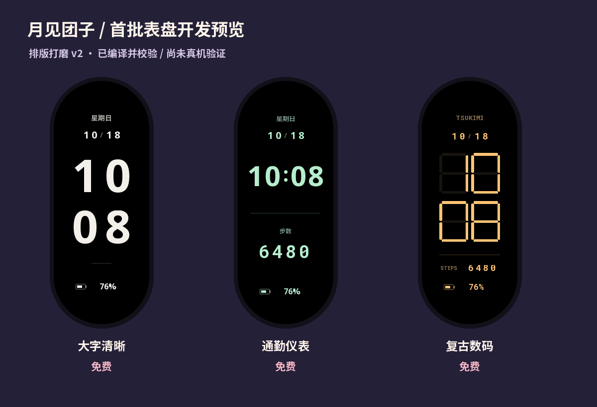

# 月见团子的小表盘

最近给小米手环9做了三款表盘，先全部免费放出来，看看大家喜欢哪一款。

- **大字清晰 F01**：黑底大字，时间放得大一点。
- **通勤仪表 F02**：浅绿色数字，时间、日期、步数和电量。
- **复古数码 P01**：琥珀色七段数字，带一点老电子钟的感觉。

## 下载

[下载免费试用包](https://github.com/Jovines/tsukimi-dango-watchfaces/releases)。

包里有三款 `.face`、预览图、安装说明和字体许可证。无需付款，不需要提供手机号或邮箱。

## 安装前看一下

这次面向**小米手环9标准版，192×490**，不适用于9 Pro或Active。当前是测试版：编译和文件完整性检查已通过，**还没在手环上实测**。不支持独立息屏表盘。先装F01；如果提示型号或格式不匹配，请停止并反馈，不要强制安装。

连接手环后，在 AstroBox「设备页 → 表盘 → ＋」选择 `.face`；未自动开始时，到队列点开始。参考[连接教程](https://abox.run/docs/usage/connection)和[安装教程](https://abox.run/docs/usage/resource)。

## 用过后告诉我

可以[提一个 Issue](https://github.com/Jovines/tsukimi-dango-watchfaces/issues/new/choose)，写一下：手环型号与固件、用了哪一款、是否装成功、哪里不顺眼。能附一张手环照片更好。特别想确认步数为0、电量0/100、星期以及熄屏后再亮屏的显示。

不要在反馈里发手机号、密码或账号密钥。

## 使用说明

三款测试版免费供个人使用；免费不代表转让表盘设计版权。字体及其衍生部分遵循各自的 SIL OFL 1.1 许可，完整文本随下载包附带。字体许可不限制你按OFL允许的方式使用字体。

这里发布下载文件和反馈入口，开发工程另行维护。

[月见团子的爱发电主页](https://afdian.com/a/yuejiantuanziface)，用来放更新和收集留言；本次三款表盘下载免费。

——月见团子
